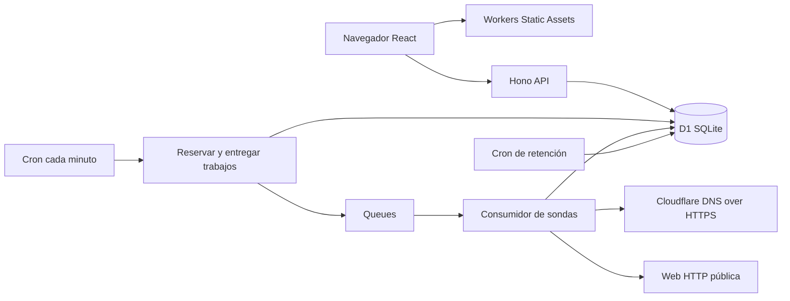

# Arquitectura del MVP de Vyrsea

Vyrsea ejecuta la aplicación y la monitorización en Cloudflare. La beta limita a diez los monitores de clientes y exime al propietario de cuotas de dominios y monitores. La capacidad de ejecución sigue acotada y no ofrece SLA ni ubicaciones garantizadas.

## Componentes

| Componente | Implementación |
| --- | --- |
| Web | React, TypeScript y Vite; portada prerenderizada al compilar, panel y acceso cargados bajo demanda; sin CDN de scripts o fuentes |
| API | Hono; respuestas JSON sin caché; mismo origen que el frontend |
| Datos | D1; esquema tipado y CRUD con Drizzle; SQL preparado para transacciones, límites y estadísticas |
| Identidad | SimpleWebAuthn, passkeys con verificación de usuario obligatoria y sesiones HttpOnly |
| Formularios | Turnstile en registro de producción, validado en servidor |
| Planificador | Un Cron por minuto, hasta diez monitores vencidos por ejecución |
| Transporte | Queue `vyrsea-checks`, un mensaje con hasta cuatro monitores; hasta tres consumidores concurrentes |
| Fallos de entrega | Tres reintentos con 60 segundos de retraso, DLQ y outbox recuperable |
| Retención | El mismo Cron por minuto ejecuta limpieza a las 03:17 UTC, eliminaciones acotadas por tabla |
| Publicación | Wrangler, Static Assets y backend en el mismo Worker; rutas inexistentes devuelven 404 |
| Dominios y cuotas | Public Suffix List con `tldts`; plan del usuario y límites autoritativos en D1 |

`compatibility_date` se fija a `2026-07-01`, compatible con el runtime local instalado. No depende de APIs exclusivas de una fecha posterior. `nodejs_compat` permite las dependencias de WebAuthn.

## Flujo de una comprobación

1. Cron consulta el índice `(paused, next_check_at)`. Los slots de idempotencia tienen resolución de un minuto; la próxima reserva respeta la frecuencia de la cuenta (Free 15 min, Starter 5 min, Pro / Agencia y Business 1 min).
2. Una transacción D1 agrupa las reservas de hasta diez monitores, añade el trabajo a `check_jobs` y avanza la próxima ejecución. La reserva evita duplicados y también se aplica al botón manual.
3. El despachador agrupa los mensajes con `sendBatch` y envía mensajes con hasta cuatro trabajos y marca su entrega **después** de que Queues acepte el mensaje. Un error de envío deja el outbox pendiente para el siguiente minuto.
4. El consumidor comprueba que el monitor siga existiendo y activo, y que el slot no se haya procesado. Valida URL y DNS A/AAAA y solicita los encabezados HTTP. Cada salto de redirección vuelve a validarse; cancela el cuerpo para no descargarlo.
5. Una transacción D1 inserta el resultado, actualiza el agregado horario, abre o cierra incidencias, genera alertas, actualiza `last_slot` y elimina el trabajo pendiente. Todas las escrituras están protegidas por el slot anterior. Una repetición no duplica estadísticas ni alertas.
6. Una reserva entregada que siga sin finalizar después de quince minutos puede reenviarse desde el outbox. Una entrega antigua se ignora si ya se registró un slot posterior. No se fabrican comprobaciones de los periodos perdidos.

El `max_concurrency: 3` y `max_batch_size: 1` permiten procesar los tres mensajes del lote actual de diez trabajos sin serializar las esperas de red entre mensajes. Los cuatro monitores de cada mensaje se procesan secuencialmente: hasta 48 peticiones externas y 40 sentencias D1 por invocación. Los límites externos e internos son distintos; el límite D1 Free sigue siendo 50 consultas. No aumentar tamaños sin recalcular este presupuesto y medir CPU. Consulta el [modelo de coste, límites actuales y evolución a 100/1.000 cuentas](capacity.md).

## Estados y estadísticas

| Situación | Estado | Acción |
| --- | --- | --- |
| Aún sin resultado | Pendiente | Esperar al programador |
| Respuesta HTTP 2xx o 3xx final | Operativo | Reiniciar fallos; cerrar una incidencia abierta |
| Primer fallo consecutivo | Confirmando | Registrar resultado sin alertar todavía |
| Segundo fallo consecutivo | Caído | Abrir una incidencia y una alerta |
| Más fallos en la misma caída | Caído | Actualizar datos, sin nueva alerta |
| Primera respuesta correcta tras una caída | Operativo | Cerrar la incidencia y crear alerta de recuperación |
| Pausado | En pausa | No reservar ni registrar sondas en curso |
| Sin datos durante más de tres intervalos del plan | Sin datos recientes en el panel | No mostrar el último resultado como si fuese actual |

La confirmación espera al siguiente ciclo del plan; no consume una segunda petición inmediata. En Free una caída nueva tarda aproximadamente entre quince y treinta minutos en confirmarse, más la espera en cola y posibles retrasos del proveedor. La apertura se fecha al confirmarla, no al primer fallo; la duración mostrada es duración confirmada.

Las ventanas de mantenimiento suspenden reservas y sondas cubiertas. La transacción de resultados vuelve a comprobar horarios para descartar peticiones que estaban en curso. No generan muestras y rompen secuencias de fallos sin cerrar incidencias previas. El [detalle técnico del mantenimiento](maintenance.md) describe límites, cancelación y reanudación.

La disponibilidad se calcula como `comprobaciones_correctas / comprobaciones_totales`, no como porcentaje de tiempo exacto. Las horas sin datos quedan vacías y no cuentan como éxitos. El panel consulta 24 buckets horarios, incluido el actual; los extremos son horas parciales. La media de respuesta incluye DNS, HTTP y cancelación del cuerpo, así como sondas fallidas; no es tiempo de carga completo de la página ni una prueba de Core Web Vitals.

## Persistencia

| Tabla | Uso |
| --- | --- |
| `users` | Identificador, usuario único, `plan_id` y cuotas/retención personalizadas de Business; máximo cien cuentas en la instalación |
| `plan_limits` | Dominios, monitores, frecuencia e histórico de los cuatro planes; solo Free contratable actualmente |
| `credentials` | Clave pública COSE, contador y transportes de la passkey |
| `challenges` | Desafío WebAuthn de un solo uso durante cinco minutos |
| `sessions` | Hash del token y vencimiento de siete días |
| `rate_limits` | Contadores por ventana y hash de IP o ID de usuario |
| `monitors` | Destino inmutable, dominio registrable `root_domain`, propietario, estado, fallos y próxima ejecución |
| `check_jobs` | Outbox de trabajos reservados que aún no han finalizado |
| `maintenance_windows` | Horarios, motivos y cancelación; pertenecen a un monitor y se conservan según la retención de la cuenta |
| `checks` | Resultados detallados recientes, ID único `monitor:slot` |
| `hourly_stats` | Totales, éxitos y suma de tiempos por monitor y hora |
| `incidents` | Apertura, resolución y causa; índice único para una incidencia abierta por monitor |
| `notifications` | Alertas de caída/recuperación y fecha de lectura |

Los `FOREIGN KEY ... ON DELETE CASCADE` eliminan los datos asociados al borrar el monitor. Los triggers de capacidad son la autoridad de los límites; el frontend muestra el plan pero no decide las cuotas. Las migraciones SQL son la fuente del esquema operativo y de los índices/triggers; no se usa `drizzle push` en producción.

No se agregan datos personales de contacto ni se verifica una dirección de correo. El nombre de usuario no acredita la propiedad de un dominio. El servicio realiza únicamente GET sin credenciales ni cabeceras personalizadas.

## Dominios y planes

Free permite un dominio registrable y dos URLs monitorizadas en total. `www.ejemplo.es` y `tienda.ejemplo.es` comparten `ejemplo.es`; `ejemplo.co.uk` se reconoce correctamente. Los sufijos privados se tienen en cuenta: `alice.github.io` y `bob.github.io` son grupos distintos. Primero se normaliza la URL con WHATWG URL, incluida la conversión de dominios internacionalizados, y después se aplica la lista de sufijos.

La primera URL crea el grupo; eliminar su último monitor libera el dominio. Pausar no libera dominio ni monitor. Cada URL distinta ocupa una plaza, aunque comparta hostname. Los targets duplicados de una cuenta se rechazan. La API solo acepta nombre y URL para crear; el cliente no puede enviar su plan ni decidir `root_domain`. Los triggers comprueban simultáneamente capacidad global, monitores del usuario y dominios distintos. El índice `(user_id, root_domain)` apoya la consulta y agrupación.

La migración `0002_domain_plans.sql` asigna Free a cuentas anteriores y conserva sus monitores e históricos. El backend completa los dominios pendientes al consultar o crear. Si una cuenta antigua supera la cuota, puede consultar, pausar, renombrar o eliminar; no se borran datos para ajustarla automáticamente. Las nuevas altas siguen las cuotas. No existe endpoint público para cambiar el plan. Las migraciones 0003 y 0004 añaden Starter, Pro / Agencia y Business, sus históricos y sus frecuencias. Los antiguos planes pro y agency pasan a Starter y Pro / Agencia respectivamente, sin borrar usuarios, passkeys, monitores o resultados. Business exige cuotas y retención explícitas por cuenta; los valores nulos no significan capacidad ilimitada. La migración aplaza las claves foráneas dentro de la transacción y se comprueba con datos previos. Suscripciones y asignación comercial siguen desactivadas.

## HTML público y herramientas para agentes

La portada completa se renderiza en la compilación con React; no consume CPU de SSR por visita. Vite genera archivos con hash y el panel/autenticación son módulos diferidos. La compilación añade canónica, Open Graph, JSON-LD, sitemap, robots, `llms.txt`, OpenAPI de lectura y 404. El catálogo público, JSON-LD y llms describen Free cada 15 minutos y siete días de histórico. Solo la portada es indexable; demo y panel añaden `noindex` en el cliente y la API envía `X-Robots-Tag`.

Si existe `document.modelContext`, la web registra herramientas WebMCP de consulta de planes y del espacio actual. La segunda solo usa la sesión que ya tiene el navegador y marca la demo como ejemplo; no expone cookies, secretos o acciones de escritura. Las herramientas se retiran con `AbortSignal` al desmontar la vista. Navegadores sin esta API conservan toda la navegación y formularios normales.

## API

| Método | Ruta | Función |
| --- | --- | --- |
| GET | `/api/health` | Versión y salud básica del proceso; no prueba D1 ni Cron |
| GET | `/api/config` | Clave pública Turnstile y disponibilidad de registro |
| GET | `/api/me` | Usuario de la sesión o null |
| GET | `/api/plans` | Cuatro planes, precios, contratación deshabilitada, proveedor Dodo Payments y sondas realmente activas |
| POST | `/api/auth/register/options` | Usuario, Turnstile y desafío de registro |
| POST | `/api/auth/register/verify` | Verificar passkey, crear usuario y sesión |
| POST | `/api/auth/login/options` | Desafío de acceso con credencial descubrible |
| POST | `/api/auth/login/verify` | Verificar firma y crear sesión |
| POST | `/api/auth/logout` | Revocar sesión actual |
| GET | `/api/dashboard` | Monitores y límites de cuenta; `days` se limita a la retención y `view=advanced` exige Pro / Agencia o Business |
| POST | `/api/monitors` | Crear con nombre y URL pública |
| PATCH | `/api/monitors/:id` | Renombrar, pausar o reanudar |
| DELETE | `/api/monitors/:id` | Eliminar monitor y datos asociados |
| POST | `/api/monitors/:id/check` | Reservar comprobación respetando el plazo mínimo y el mantenimiento |
| POST | `/api/monitors/:id/maintenance` | Programar una ventana para un monitor propio |
| POST | `/api/monitors/:id/maintenance/:windowId/cancel` | Cancelar de forma idempotente sin borrar el registro |
| GET | `/api/monitors/:id/history` | Bloques de cien dentro del histórico del plan; cursor `before` y filtro `result=all/failed/ok` |
| POST | `/api/notifications/read` | Marcar todas las alertas de la cuenta como leídas |

Todas las rutas de datos requieren sesión; todas las escrituras exigen JSON y `Origin` exacto. No hay CORS entre sitios, endpoint público para disparar Cron ni token administrativo incluido en el frontend.

## Acceso supervisado

El registro crea cuentas pendientes. El propietario aprueba y suspende desde un panel privado. La elegibilidad de cuenta y su fecha de actividad se verifican al reservar, consumir y guardar resultados. Free sin uso durante más de 14 días queda suspendido (una hora de margen por las escrituras de actividad agrupadas). Los planes de pago y el propietario están exentos. Consulta [la política y el aprovisionamiento seguro del propietario](account-access.md).

Agrupar consultas reduce viajes al servicio D1, pero no elimina las filas escritas ni las operaciones facturables de Queues. Cada resultado conserva su transacción atómica y el histórico por comprobación. No se aumenta la capacidad global de diez monitores.

Se registra un único disparador Cron para Vyrsea; la limpieza diaria se integra a las 03:17 UTC. Así se ocupa una sola plaza del límite de disparadores compartido por la cuenta Free.
